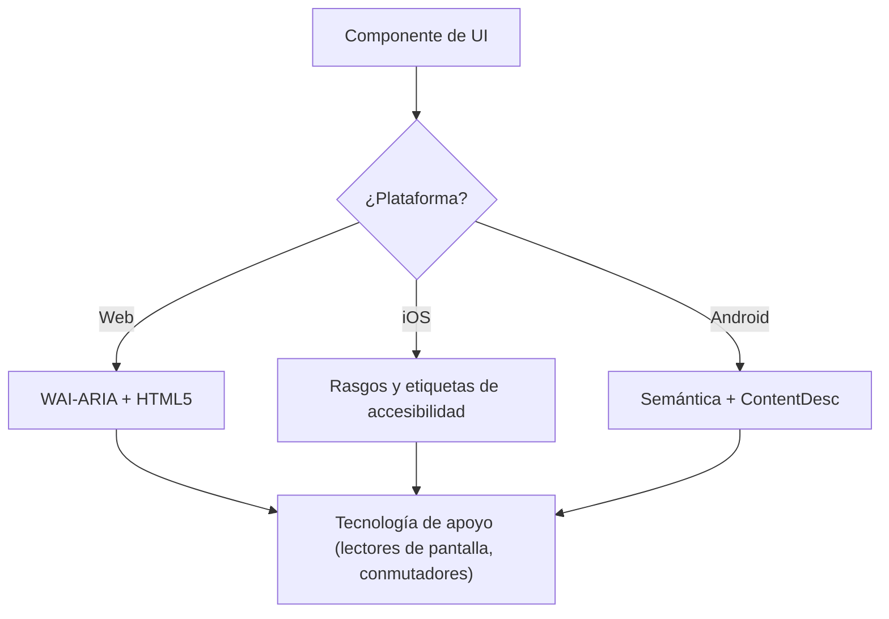

<!-- Traducción al español de `skills/accessibility/SKILL.md` de affaan-m/ECC (licencia MIT), con una sección final de adaptación a este proyecto. -->

# Accesibilidad (WCAG 2.2)

Esta skill garantiza que las interfaces digitales sean perceptibles, operables, comprensibles y robustas (POUR) para todos los usuarios, incluidos quienes usan lectores de pantalla, controles por conmutador o navegación con teclado. Se centra en la implementación técnica de los criterios de conformidad de WCAG 2.2.

## Cuándo usarla

- Al definir las especificaciones de componentes de UI para Web, iOS o Android.
- Al auditar código existente en busca de barreras de accesibilidad o carencias de cumplimiento.
- Al implementar los nuevos estándares de WCAG 2.2, como el tamaño del objetivo (mínimo) y la apariencia del foco.
- Al traducir requisitos de diseño de alto nivel a atributos técnicos (roles ARIA, rasgos, pistas).

## Conceptos clave

- **Principios POUR**: la base de WCAG (perceptible, operable, comprensible, robusto).
- **Correspondencia semántica**: usar elementos nativos en lugar de contenedores genéricos para obtener accesibilidad integrada.
- **Árbol de accesibilidad**: la representación de la UI que las tecnologías de apoyo realmente «leen».
- **Gestión del foco**: controlar el orden y la visibilidad del cursor del teclado o del lector de pantalla.
- **Etiquetas y pistas**: dar contexto mediante `aria-label`, `accessibilityLabel` y `contentDescription`.

## Cómo funciona

### Paso 1: Identificar el rol del componente

Determina su propósito funcional (por ejemplo, ¿es un botón, un enlace o una pestaña?). Usa el elemento nativo más semántico disponible antes de recurrir a roles personalizados.

### Paso 2: Definir los atributos perceptibles

- Asegura que el contraste del texto alcance **4.5:1** (normal) o **3:1** (grande/UI).
- Añade alternativas textuales para el contenido no textual (imágenes, iconos).
- Implementa el reajuste responsivo (hasta un 400 % de zoom sin pérdida de funcionalidad).

### Paso 3: Implementar controles operables

- Asegura un tamaño de objetivo mínimo de **24x24 píxeles CSS** (WCAG 2.2, criterio 2.5.8).
- Verifica que todos los elementos interactivos se alcancen con el teclado y tengan un indicador de foco visible (criterio 2.4.11).
- Ofrece alternativas de un solo puntero para los movimientos de arrastre.

### Paso 4: Asegurar una lógica comprensible

- Usa patrones de navegación consistentes.
- Ofrece mensajes de error descriptivos y sugerencias de corrección (criterio 3.3.3).
- Implementa la «entrada redundante» (criterio 3.3.7) para no pedir dos veces los mismos datos.

### Paso 5: Verificar la compatibilidad robusta

- Usa patrones correctos de `Name, Role, Value` (nombre, rol, valor).
- Implementa `aria-live` o regiones activas para las actualizaciones de estado dinámicas.

## Diagrama de la arquitectura de accesibilidad



## Correspondencia entre plataformas

| Función                      | Web (HTML/ARIA)          | iOS (SwiftUI)                        | Android (Compose)                                           |
| :--------------------------- | :----------------------- | :----------------------------------- | :---------------------------------------------------------- |
| **Etiqueta principal**       | `aria-label` / `<label>` | `.accessibilityLabel()`              | `contentDescription`                                        |
| **Pista secundaria**         | `aria-describedby`       | `.accessibilityHint()`               | `Modifier.semantics { stateDescription = ... }`             |
| **Rol de acción**            | `role="button"`          | `.accessibilityAddTraits(.isButton)` | `Modifier.semantics { role = Role.Button }`                 |
| **Actualizaciones en vivo**  | `aria-live="polite"`     | `.accessibilityLiveRegion(.polite)`  | `Modifier.semantics { liveRegion = LiveRegionMode.Polite }` |

## Ejemplos

### Web: búsqueda accesible

```html
<form role="search">
  <label for="search-input" class="sr-only">Buscar productos</label>
  <input type="search" id="search-input" placeholder="Buscar..." />
  <button type="submit" aria-label="Enviar búsqueda">
    <svg aria-hidden="true">...</svg>
  </button>
</form>
```

### iOS: botón de acción accesible

```swift
Button(action: deleteItem) {
    Image(systemName: "trash")
}
.accessibilityLabel("Eliminar elemento")
.accessibilityHint("Quita este elemento de tu lista de forma permanente")
.accessibilityAddTraits(.isButton)
```

### Android: interruptor accesible

```kotlin
Switch(
    checked = isEnabled,
    onCheckedChange = { onToggle() },
    modifier = Modifier.semantics {
        contentDescription = "Activar notificaciones"
    }
)
```

## Antipatrones que evitar

- **Botones-div**: usar un `<div>` o un `<span>` para un evento de clic sin añadir un rol ni compatibilidad con el teclado.
- **Significado solo por color**: indicar un error o un estado _solo_ con un cambio de color (por ejemplo, poner un borde en rojo).
- **Foco del modal sin contener**: modales que no atrapan el foco y permiten a los usuarios de teclado recorrer el contenido de fondo mientras el modal está abierto. El foco debe quedar contenido _y_ poder salir con la tecla `Escape` o con un botón de cierre explícito (WCAG, criterio 2.1.2).
- **Texto alternativo redundante**: usar «Imagen de...» o «Foto de...» en el texto alternativo (los lectores de pantalla ya anuncian el rol «Imagen»).

## Lista de buenas prácticas

- [ ] Los elementos interactivos alcanzan el tamaño de objetivo de **24x24px** (Web) o **44x44pt** (nativo).
- [ ] Los indicadores de foco son claramente visibles y de alto contraste.
- [ ] Los modales **contienen el foco** mientras están abiertos y lo liberan limpiamente al cerrarse (tecla `Escape` o botón de cierre).
- [ ] Los desplegables y menús devuelven el foco al elemento que los abrió al cerrarse.
- [ ] Los formularios ofrecen sugerencias de error en texto.
- [ ] Todos los botones de solo icono tienen una etiqueta de texto descriptiva.
- [ ] El contenido se reajusta correctamente cuando se escala el texto.

## Referencias

- [Pautas WCAG 2.2](https://www.w3.org/TR/WCAG22/)
- [Prácticas de creación de WAI-ARIA](https://www.w3.org/TR/wai-aria-practices/)
- [Guía de programación de accesibilidad de iOS](https://developer.apple.com/documentation/accessibility)
- [Directrices de interfaz humana de iOS: accesibilidad](https://developer.apple.com/design/human-interface-guidelines/accessibility)
- [Guía para desarrolladores de accesibilidad de Android](https://developer.android.com/guide/topics/ui/accessibility)

## Skills relacionadas

- `frontend-patterns`
- `design-system`
- `liquid-glass-design`
- `swiftui-patterns`

## Adaptación a este proyecto

Esta sección no forma parte de la traducción: la añade el proyecto y **prevalece sobre el texto anterior** donde lo contradiga.

- **Stack real:** solo Web. Koa con SSR, HTML5 semántico, Tailwind CSS, BEM y JavaScript Vanilla (`public/js`), TypeScript en el backend, sin React. Landings en `restaurante/landing-pages/` y admin en `restaurante/inventory-manager/`. **No aplican** los ejemplos y referencias de iOS (SwiftUI) y Android (Compose), ni las skills relacionadas `frontend-patterns`, `liquid-glass-design` y `swiftui-patterns`, que no existen en este proyecto; sí `design-system`.
- **Reglas del proyecto:** esta skill amplía `.claude/rules/accesibilidad.md` y `.claude/rules/formularios.md`, que son obligatorias. En particular, ARIA solo cuando un elemento nativo no lo resuelva (el ejemplo de `<form role="search">` es aceptable; un `role="button"` sobre un `div` no).
- **`./_stich_source_/` prevalece** en lo visual (colores, foco, tamaños). Si una definición del diseño fuente no alcanza el contraste o el tamaño de objetivo de WCAG 2.2 AA, no la cambies por tu cuenta: señálalo como hallazgo para que el usuario decida.
- **Avisos del día (modales):** deben contener el foco, cerrarse con `Escape` y devolver el foco; sin JavaScript no tapan nada (`.claude/CLAUDE.md` §5).
- **Orquestación (`.claude/CLAUDE.md` §4):** los subagentes no invocan a otros subagentes ni esperan al usuario; la sesión principal orquesta. Las correcciones las hace `senior-fullstack`, el único que hace commits y PR, en su fase.
- **Pruebas:** las auditorías son evidencia; solo queda una prueba permanente si protege un comportamiento funcional que nada cubre o si el usuario la pide (`.claude/rules/testing.md`). Limpia procesos, pestañas y archivos temporales.
- **CodeGraph primero** para `public/js` y los controladores; Read y Grep para las plantillas HTML y `_stich_source_/`. No envíes capturas, datos personales, credenciales ni información de producción a servicios externos.
