# Auditoría de interfaces y navegación (REQ-F-048)

Esta auditoría revisa la interfaz y la navegación de las landings (`/`, `/birria` y `/molotes`, con sus avisos del día) y del admin (`inventory-manager`), con evidencia. **Solo diagnostica: no cambia nada.**

- Es la entrada de los tickets derivados (REQ-F-049 y siguientes).
- Las decisiones que tiene que tomar el usuario están al final, con la propuesta de esos tickets.

## 1. Resumen

| Severidad | Total | Landings | Admin | Origen: diseño fuente | Origen: implementación |
| --- | ---: | ---: | ---: | ---: | ---: |
| Crítica | 0 | 0 | 0 | 0 | 0 |
| Alta | 2 | 2 | 0 | 2 | 0 |
| Media | 6 | 4 | 2 | 4 | 2 |
| Baja | 13 | 12 | 1 | 7 | 6 |
| **Total** | **21** | **18** | **3** | **13** | **8** |

**Lo más importante:**

1. **AUD-001 (Alta, diseño fuente):** los botones "Ordenar ya!" de WhatsApp, la acción principal de las dos landings, tienen texto blanco sobre `#25D366`, con un contraste de 1.98:1. Se confirma C2.
2. **AUD-002 (Alta, diseño fuente):** el texto del hero de Molotes sobre el fondo azul claro va de 1.33:1 a 2.87:1. El título, "Punto de Oro", la descripción y el botón secundario no llegan a AA.
3. **AUD-005 (Media, diseño fuente):** por debajo de 1024 px las landings no tienen navegación entre secciones. En Birria no hay ningún camino a las secciones salvo desplazarse. En Molotes, la única navegación está en el pie, al final de una página de unos 9 800 px a 375 px. Se confirman H1, H2 y C1.
4. **AUD-006 (Media, implementación):** a 375 px, la cabecera del admin mide 273 px (el 34 % de la pantalla) para un administrador en Birria. No hay un patrón móvil. Se confirma H4.
5. **AUD-007 (Media, implementación):** el CTA flotante tapa parcialmente los botones del hero de Molotes, también cuando tienen el foco, y, al final de las dos landings, los textos legales del pie. Esos textos no reciben el foco, y ningún elemento con el foco queda tapado por completo, así que 2.4.11 se cumple.

**Lo que está bien** (comprobado y sin hallazgo):

- Ninguna pantalla se desborda en horizontal en ningún ancho, ni a 320 px ni con el zoom al 200 %.
- Todos los elementos del documento principal que reciben el foco tienen un indicador visible. En las landings suele ser el anillo de foco por defecto del navegador (`outline: auto`): se ve, pero no es un estilo del proyecto. En el admin, los enlaces y botones tienen un `outline` de 2 px `#eab308`, pero los campos de formulario solo cambian el color del borde (AUD-021). No se evaluaron las 16 paradas internas de cada iframe del mapa (AUD-010), ni se midió el contraste del indicador de foco (1.4.11 y 2.4.7, 3:1): ver "Límites".
- Los "saltar al contenido" funcionan.
- Cada página tiene un solo `h1`, los encabezados siguen un orden lógico y los landmarks están completos.
- Los avisos son `<dialog>` modales. Contienen el foco, se cierran con `Esc` y con su botón, no reaparecen al recargar en la misma sesión y, sin JavaScript, no se ven ni tapan nada.
- Los errores de los formularios del admin se resumen en un `role="alert"` que recibe el foco, con `aria-invalid`.
- Las páginas 403, 404 y 503 del admin son claras.
- Los objetivos táctiles del admin miden 44 px de alto con dos excepciones: las casillas (20 × 20 px), que cumplen la excepción de espaciado de 2.5.8, y la marca "Administración" de la cabecera, que mide 28 px de alto (por encima del mínimo de 24 px).

## 2. Método y entorno

- **Fecha:** 2026-11-18.
- **Código auditado:** `main` en `6d86fde`.
- **Navegador:** Google Chrome 157.0.8103.79 en modo headless, controlado por Chrome DevTools Protocol desde un script desechable de Node 24.22.1. Usa el `WebSocket` nativo: sin Puppeteer, Playwright ni axe-core, y sin tocar ningún `package.json`. El perfil del navegador era nuevo y temporal.
- **Entorno local aislado:**
  - un MySQL 8.4 desechable (proyecto de Compose `restaurante-auditoria`, borrado al terminar), migrado con `npm run db:migrate` y con los datos semilla que publica la `api` al arrancar;
  - las tres apps en `127.0.0.1` (3001, 3000 y 3003) con archivos de entorno propios, sin los `.env` del desarrollador, sin bot y con números de WhatsApp ficticios;
  - dos usuarios de prueba, un administrador y una editora solo de Molotes con un nombre visible de 60 caracteres (el máximo), con contraseñas aleatorias que no aparecen en este documento;
  - no se usó ni la base de desarrollo ni producción.
- **Anchos:**
  - 375 × 812 (móvil, táctil emulado), 768 × 1024, 1440 × 900 y, solo en las landings, 1023 y 1024 × 768 (el umbral `lg`);
  - **zoom al 200 %:** viewport de 640 × 400 con `deviceScaleFactor: 2`, equivalente a una ventana de 1280 px al 200 %, y reflow a 320 × 640 (WCAG 1.4.10);
  - **horizontal:** 812 × 375.
- **Avisos:** se forzaron con `?dia=lunes|martes|sabado`, que solo funciona con `NODE_ENV=development`, cada uno en una sesión de navegador nueva. El aviso del día real (miércoles: "Molotes" en `/`) se capturó sin el parámetro. Se forzaron todos los avisos del alcance.
- **Contraste:** relación de WCAG 2.x, `(L1 + 0.05) / (L2 + 0.05)`. Se usan el color calculado del texto y el fondo efectivo, que se obtiene componiendo con su alfa los fondos que hay bajo el texto (`elementsFromPoint`). Los colores en `oklch` se convierten a sRGB con un `<canvas>`.
  - Si el fondo es una imagen o un degradado, se captura la zona y se mide una banda de 3 px alrededor del texto. Se reportan el **peor caso** (percentil 5) y la mediana.
  - Umbrales: 4.5:1 para texto normal y 3:1 para texto grande (≥ 24 px, o ≥ 18.66 px en negrita) y para componentes no textuales.
  - La sombra de texto (`text-shadow`) no se tiene en cuenta.
- **Objetivos táctiles:** `getBoundingClientRect()` de cada elemento interactivo visible.
  - El mínimo de WCAG 2.5.8 es 24 × 24 px. Si un objetivo es menor, se comprueba la excepción de espaciado: el círculo de 24 px centrado en él no debe cortar a ningún otro objetivo.
  - 44 × 44 px es la recomendación.
  - Los enlaces dentro de un párrafo quedan exentos.
- **Teclado:** se pulsó Tab hasta 260 veces por página. En cada paso se anotaron el elemento con el foco, su `outline` o `box-shadow`, si estaba dentro del viewport y si otro elemento lo tapaba (`elementFromPoint`). En los avisos se probaron también `Esc`, el botón de cierre y adónde vuelve el foco.
- **Estructura:** encabezados, landmarks y nombres accesibles, estos últimos con el árbol de accesibilidad del navegador (`Accessibility.getPartialAXTree`).
- **Diseño fuente:**
  - las landings se comparan con los `code.html` de escritorio y móvil;
  - el admin, con `_stich_source_/birrier_a_el_mu_eco/DESIGN.md`;
  - no se reportan como hallazgo las "Diferencias deliberadas con el diseño fuente" del README, salvo que incumplan un criterio.
- **Límites:**
  - sin lector de pantalla real (solo el árbol de accesibilidad);
  - sin dispositivos físicos: el zoom, el táctil y la orientación están emulados;
  - el contraste sobre imágenes depende de la imagen;
  - la sombra de texto no se mide;
  - capturas del diseño: el `screen.png` de escritorio de Moloteando es válido (1280 × 4459). En la segunda ronda se usó para confirmar el origen de AUD-002, AUD-003 y AUD-012: el hero blanco sobre azul claro, el "Inicio" activo azul oscuro y el icono de persona. Las de Birria escritorio (dañada) y las móviles (miniaturas) no sirven (AUD-018), así que para esas se usaron los `code.html`;
  - el contraste sobre imagen o degradado se mide muestreando píxeles. Otro muestreo (otra banda, otro percentil, otro desplazamiento del fondo) da cifras algo distintas: en la ronda 1 de QA, por ejemplo. Por eso los hallazgos dan el peor caso (percentil 5 de una banda de 3 px) y la mediana. Las conclusiones no cambian;
  - no se midió el contraste del indicador de foco (1.4.11 y 2.4.7, 3:1 frente a los colores adyacentes). Solo se comprobó que existe;
  - no se auditaron 1.4.12 (espaciado del texto) ni 2.5.3 (etiqueta en el nombre). De 1.3.5 (propósito de los campos) solo se revisaron los formularios del club (AUD-020);
  - revisado sin hallazgo: `aria-current="page"` fijo en el enlace "Inicio" (`#inicio`) de las dos navegaciones. Identifica la página, que es una sola; no sigue a la sección visible.
- **Cómo reproducirlo:** el procedimiento completo está en la sección "Technical Action Plan" del ticket REQ-F-048 (`.claude/docs/`): entorno aislado, casos y mediciones.

## 3. Escala de severidad

| Severidad | Definición |
| --- | --- |
| Crítica | Impide una tarea principal (pedir por WhatsApp, entrar al admin, guardar) a un grupo de usuarios (teclado, lector de pantalla, móvil) sin alternativa |
| Alta | Incumple WCAG 2.2 AA en un flujo principal, o dificulta mucho la tarea y la alternativa es costosa |
| Media | Incumple AA en un flujo secundario, o degrada la experiencia con una alternativa razonable |
| Baja | Recomendación (p. ej. 44 px), consistencia visual o mantenimiento |

## 4. Inventario de pantallas revisadas

"Sí" quiere decir que se capturó y se midió (estructura, desborde, contraste y objetivos). Las capturas que no respaldan un hallazgo no están en el repositorio (decisión D1).

| Superficie | Ruta | Rol | 375 | 768 | 1024 | 1440 | Otros |
| --- | --- | --- | --- | --- | --- | --- | --- |
| Inicio, aviso "Descanso" | `/?dia=lunes` | Público | Sí | Sí | — | Sí | |
| Inicio, aviso "Molotes" | `/?dia=martes` y `/` (día real) | Público | Sí | Sí | — | Sí | Horizontal y sin JS |
| Inicio sin aviso | `/?dia=sabado` | Público | Sí | — (misma vista que `/birria`, medida a 768) | — | — (misma vista que `/birria`, medida a 1440) | `/` sin aviso sirve exactamente la landing de Birria |
| Landing Birria | `/birria` (y `?dia=lunes`: sin aviso) | Público | Sí | Sí | Sí (y 1023) | Sí | Zoom, 320, horizontal y API caída |
| Landing Molotes | `/molotes?dia=martes` | Público | Sí | Sí | Sí (y 1023) | Sí | Zoom, 320 y horizontal |
| Molotes, aviso "Descanso" | `/molotes?dia=lunes` | Público | Sí | Sí | — | Sí | Sin JS |
| Molotes, aviso "Hoy toca birria" | `/molotes?dia=sabado` | Público | Sí | Sí | — | Sí | Sin JS |
| Inicio de sesión | `/acceso` | Sin sesión | Sí | Sí | — | Sí | API caída |
| Productos | `/molotes/productos` y `/birria/productos` | Admin y editora | Sí | Sí | — | Sí | Zoom, 320 y horizontal |
| Alta de producto | `/molotes/productos/nuevo?categoria=platillo` | Admin | Sí | Sí | — | Sí | Error |
| Edición de producto | `/birria/productos/11/editar` y `/molotes/productos/1/editar` | Admin | Sí | Sí | — | Sí | Éxito |
| Productos eliminados | `/molotes/productos/eliminados` | Admin | Sí | Sí | — | Sí | Vacío |
| Página | `/birria/pagina` y `/molotes/pagina` | Admin y editora | Sí | Sí | — | Sí | |
| Usuarios (lista) | `/usuarios` | Admin (editora: 403) | Sí | Sí | — | Sí | API caída: 503 |
| Usuarios (formulario) | `/usuarios/nuevo` y `/usuarios/2/editar` | Admin | Sí | Sí | — | Sí | Error y éxito |
| Mi cuenta | `/cuenta` | Admin y editora | Sí | Sí | — | Sí | |
| Bot | `/bot` | Admin (editora: 403) | Sí | Sí | — | Sí | Vacío |
| Cotizador | `/birria/cotizador` | Admin (editora: 403) | Sí | Sí | — | Sí | Zoom, 320 y horizontal |
| 404 | `/no-existe` | Con y sin sesión | Sí | Sí | — | Sí | |
| API no disponible (503) | `/molotes/productos`, `/usuarios` y el envío de `/acceso` | Admin | Sí | Sí | — | Sí | |

No queda ninguna superficie del alcance sin cubrir. El admin no se auditó a 1024 px, por la decisión D1b.

## 5. Navegación móvil (CA-2) y verificación de H1-H4, C1 y C2

### 5.1 Landings a 375 px (AUD-005)

**Birria (`/` y `/birria`):**

- La cabecera solo tiene la marca, que es un enlace a `#inicio`.
- La navegación "Principal" existe en el HTML, pero está oculta (`hidden lg:flex`).
- Para llegar a cada sección el usuario tiene que desplazarse. El único atajo es "Conoce nuestra birria", en el hero, que lleva a `#el-ritual`.
- El CTA flotante de WhatsApp siempre está visible.
- El pie no tiene navegación.

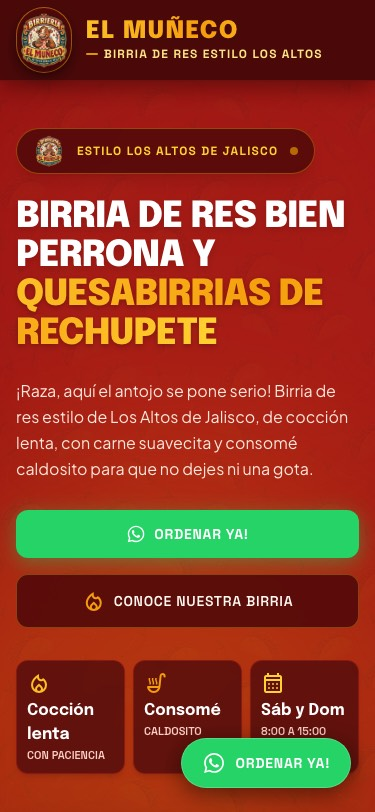

**Molotes (`/molotes`):**

- La cabecera tiene la marca, el CTA "Ordenar ya!" y un icono decorativo (AUD-012).
- La navegación "Principal" está oculta.
- La única navegación por secciones es la del pie, "Navegación Fonda", con cinco enlaces, que empieza unos 9 270 px más abajo del principio de una página de 9 796 px.

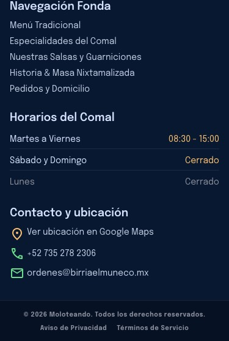

**El umbral de 1024 px:**

- A 1023 px la navegación sigue oculta y a 1024 aparece. El cambio es exacto y no deja huecos.
- A 1024 px, en Birria, los 6 elementos caben en una fila, pero varias etiquetas ("Menú de Birria", "Quesabirrias & Consomé", "Nuestra Birria" y "Ordenar ya!") se parten en dos líneas.

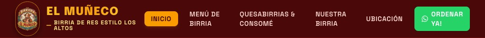

**Origen: diseño fuente.** Los cuatro `code.html` (escritorio y móvil) declaran `<nav class="hidden lg:flex">` sin botón de menú.

- H1 y H2 confirmados.
- Esto incumple `.claude/rules/diseno-responsivo.md` (mobile-first) y la HU-1.
- Se descarta 2.4.5, que se refiere a conjuntos de páginas. Sí es un **posible incumplimiento de 1.4.10 (Reflow)**, según cómo se interprete: a 320 px y con el zoom al 200-400 % se pierde la navegación entre secciones, que sí existe a 1280 px. No hay desborde.
- Es el conflicto **C1**: decisión D2.

### 5.2 Admin a 375 px (AUD-006)

- **Administrador en un negocio de Birria:**
  - la cabecera muestra "Administración", la navegación "Secciones" (Molotes, Birria El Muñeco, Usuarios y Bot), el nombre del usuario, "Mi cuenta", "Salir" y la subnavegación (Productos, Página y Cotizador);
  - son 9 enlaces, todos de 44 px de alto, en 5 filas;
  - la cabecera mide **273 px** (el 34 % de 812) y no es fija: se va al desplazar.
- **Administrador fuera de un negocio** (Usuarios, Bot, Mi cuenta): 217 px.
- **Editora (solo Molotes):** 197 px, con "Molotes", "Productos" y "Página" y sin "Usuarios", "Bot", "Birria" ni "Cotizador", como corresponde a su rol.
- Todas las secciones se alcanzan con un toque, sin menú intermedio, pero el contenido empieza a 273 px.
- A 320 px la cabecera mide 337 px con el usuario `auditoria-admin` (15 caracteres) en el Cotizador. Esta cifra depende de lo largo que sea el nombre y de la sección. QA midió 325 px en su entorno; la conclusión no cambia.
- Con el zoom al 200 % mide 221 px de 400: más de la mitad de la pantalla.

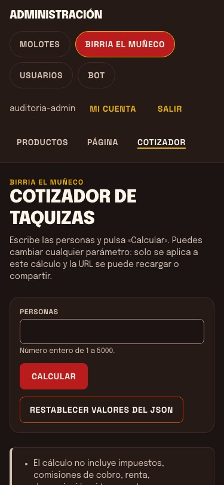

**Origen: implementación.** `DESIGN.md` no define una cabecera móvil, así que el `flex-wrap` actual no viene del diseño. H4 confirmado.

### 5.3 C2 (contraste del diseño fuente)

Confirmado y medido: blanco sobre `#25D366` da **1.98:1** (AUD-001). En las landings hay más contrastes del diseño fuente por debajo de AA: AUD-002, AUD-003 y AUD-004.

## 6. Recorridos con teclado (CA-3)

**Qué cuenta como "cada superficie"** (decisión del usuario tras la ronda 1 de QA): un recorrido con teclado de cada landing (Birria y Molotes, a 375 y a 1440) con todos sus avisos, y uno del admin, que comparte cabecera, componentes y estilos de foco en todas sus pantallas (el Cotizador a 375 y Productos a 1440). No se hizo un recorrido por cada pantalla del admin.

| Superficie | Orden de foco (abreviado) | Foco visible | Saltar al contenido | Observaciones |
| --- | --- | --- | --- | --- |
| `/birria` a 375 | Saltar → marca → "Ordenar ya!" (hero) → "Conoce nuestra birria" → … → variantes de las tarjetas → "Cómo llegar" → "Abrir en Google Maps" → plataformas → formulario del club → "Activar promoción" → "Conoce nuestros molotes" → teléfono → correo → ubicación → CTA flotante | Sí, en las 22 paradas del documento (anillo por defecto del navegador, `outline: auto`, o `outline` del proyecto de 2-3 px) | Funciona: el siguiente Tab llega al "Ordenar ya!" del hero | El ciclo completo tiene 39 paradas: las 22 del documento, 16 dentro del iframe del mapa (AUD-010) y 1 en la que el foco sale de la página. El CTA flotante es la última parada, aunque se ve siempre |
| `/birria` a 1440 | Igual, más los 6 enlaces de la navegación tras la marca | Sí, en las 28 paradas del documento | Funciona | Ciclo de 45 paradas: 28 + 16 del iframe + 1. Sin paradas tapadas |
| `/molotes` a 375 | Saltar → marca → "Ordenar ya!" (cabecera) → hero → plataformas → "Cómo llegar" → club (nombre y correo) → "Activar promoción" → "Conoce nuestra birria" → navegación del pie (5) → ubicación → teléfono → correo → CTA flotante | Sí, en las 21 paradas del documento | Funciona | Los botones del hero, con el foco, quedan tapados a medias por el CTA flotante (AUD-007). En este recorrido el iframe del mapa aún no se había cargado (`loading="lazy"`). Con el mapa cargado también tiene 16 paradas (AUD-010) |
| `/molotes` a 1440 | Igual, más los 6 enlaces de la navegación | Sí, en las 26 paradas | Funciona | — |
| Admin `/birria/cotizador` a 375 | Saltar → marca → Molotes → Birria → Usuarios → Bot → Mi cuenta → Salir → Productos → Página → Cotizador → Personas → Calcular → Restablecer → 5 `
` | Enlaces y botones: `outline` de 2 px `#eab308` (9.45:1 sobre `#1c1412`). El campo "Personas" solo cambia el color del borde (AUD-021) | Funciona: el foco va al formulario | Hay 10 paradas de cabecera antes del contenido: el skip link es necesario y funciona |
| Admin `/molotes/productos` a 1440 | Saltar → cabecera (10) → Agregar platillo → Agregar bebida → Ver eliminados → por producto: Subir, Bajar, Editar y Eliminar | Sí | Funciona: "Agregar platillo" | Los botones dicen a qué producto se refieren ("Bajar Molotes de…") |

**Avisos** (en `/` y en `/molotes`, a 375, 768 y 1440, con `?dia=`):

| Comprobación | Resultado |
| --- | --- |
| Apertura | Se abre al cargar como `<dialog>` modal (`:modal`). El foco va a la primera acción del aviso ("Mañana hay molotes", "¡Ordenar ya!", "Ver Birria El Muñeco" o "Ver el menú") |
| Tab y Shift+Tab | El foco permanece dentro del `<dialog>` y no alcanza el fondo, que queda inerte. Se comprobó con `document.activeElement` en cada pulsación |
| `Esc` | Lo cierra en todos los casos |
| Botón ("Cerrar", "Quedarme en Molotes" o "Ver el menú") | Lo cierra en todos los casos |
| Retorno del foco | Vuelve al documento (`body`): el aviso se abre sin que nadie haya enfocado nada, así que no hay un elemento anterior al que volver. El siguiente Tab empieza por "Saltar al contenido". Sugerencia (derivado B1): al cerrar, llevar el foco a `main` o al `h1` |
| Una vez por sesión | Al recargar en la misma sesión no reaparece |
| En el móvil | No tapa el CTA flotante, que queda inerte bajo el fondo del modal. El fondo **sí se desplaza** con la rueda o el gesto (AUD-008) |
| En horizontal (812 × 375) | El aviso mide 343 px de alto y su contenido se desplaza (`overflow-y: auto`): se puede leer y cerrar |
| Sin JavaScript | El `<dialog>` llega cerrado, no ocupa espacio y los CTA de WhatsApp siguen visibles. Comprobado en `/?dia=martes`, `/molotes?dia=sabado` y `/molotes?dia=lunes` |
| `/birria` | No muestra aviso, tampoco con `?dia=lunes` |

## 7. Hallazgos

### AUD-001: el texto de los botones de WhatsApp no tiene contraste suficiente

| Campo | Contenido |
| --- | --- |
| Superficie y ruta | Landings Birria y Molotes: `/`, `/birria` y `/molotes` (botón de la cabecera, del hero y flotante) |
| Ancho | Todos (375, 768, 1024 y 1440) |
| Descripción | El texto "Ordenar ya!" de la acción principal (12-14 px, en negrita) es blanco sobre verde WhatsApp y cuesta leerlo, sobre todo al sol en el móvil |
| Evidencia | Medición: `#ffffff` sobre `#25d366` = **1.98:1** (necesita 4.5:1). Captura: 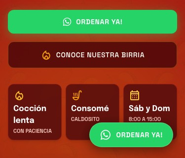 |
| Criterio | WCAG 2.2, 1.4.3 Contraste (mínimo) |
| Origen | `diseño fuente`: `bg-[#25D366] text-white` en los `code.html` de las dos landings |
| Severidad | Alta |
| Recomendación | Texto oscuro sobre el verde (p. ej. `#0b2e13` da 7.49:1) o un verde más oscuro con texto blanco (`#117a42` da 5.40:1). Hay que decidirlo con la marca, porque cambia la identidad (C2 y R3) |
| ¿Decisión sobre `_stich_source_`? | Sí: cambia un color del diseño fuente (RN-3 y D5) |

### AUD-002: el texto del hero de Molotes se lee mal sobre el fondo azul claro

| Campo | Contenido |
| --- | --- |
| Superficie y ruta | Landing Molotes, `/molotes`, hero |
| Ancho | 375 y 1440 (el fondo es más claro en escritorio) |
| Descripción | El título, "Punto de Oro", la descripción y el botón "Conoce nuestra tradición" van sobre el patrón azul claro del fondo. En escritorio el botón secundario casi desaparece |
| Evidencia | Peor caso y mediana de la banda alrededor de cada texto, a 375 / 1440: título `#ffffff` sobre `#63a5d1` / `#87b9dc` = 2.68 / 2.10 (medianas 2.87 / 2.23; necesita 3:1, texto grande); "Punto de Oro" `#ffc472` sobre `#6aa9cc` / `#92bedd` (peor caso de la banda de píxeles) = 1.64 / 1.26; descripción `#f0f9ff` sobre `#6db0cb` / `#98c8e9` = 2.26 / 1.67 (necesita 4.5:1); "Conoce nuestra tradición" `#ccdbff` sobre `#659dc8` / `#7db2e0` (peor caso) = 2.10 / 1.63. Los ratios **no tienen en cuenta** la sombra del título (`[text-shadow:0_2px_8px_rgba(0,30,60,.35)]`, `molotes.html`:54). El título es el caso más cercano a 3:1 (medianas 2.87 y 2.23), así que la sombra podría mejorarlo algo, pero no se puede medir con este método. Son el peor caso (percentil 5) y la mediana de una banda de 3 px. Otros muestreos dan cifras algo distintas sin cambiar la conclusión (§2). Captura:  |
| Criterio | WCAG 2.2, 1.4.3 Contraste (mínimo) |
| Origen | `diseño fuente`: `moloteando_aut_nticos_molotes_artesanales/code.html`, título blanco con `text-shadow` suave sobre el mismo fondo; botón `bg-primary-container/25 text-on-primary-container` |
| Severidad | Alta |
| Recomendación | Una capa oscura bajo el texto (degradado o panel translúcido azul marino) o un fondo más oscuro en el hero; el botón secundario, con fondo sólido |
| ¿Decisión sobre `_stich_source_`? | Sí |

### AUD-003: etiquetas de tarjeta y enlace activo de Molotes con azul oscuro sobre azul

| Campo | Contenido |
| --- | --- |
| Superficie y ruta | Landing Molotes, `/molotes`: etiquetas de las tarjetas del menú y enlace activo "Inicio" de la navegación |
| Ancho | Etiquetas: todos. Navegación: ≥ 1024 |
| Descripción | Las etiquetas "Favorito" y "Sabor de casa" (9 px) y el enlace activo "Inicio" (12 px) usan azul oscuro sobre azul medio. La etiqueta "Toque gourmet" (blanco sobre azul claro, 9 px) también incumple: es texto normal y necesita 4.5:1 |
| Evidencia | `#002f67` sobre `#1b5eb8` = **2.08:1** (etiquetas de 9 px y enlace activo de 12 px); `#ffffff` sobre `#0084d1` = **4.02:1** ("Toque gourmet", 9 px; necesita 4.5:1). Capturas:  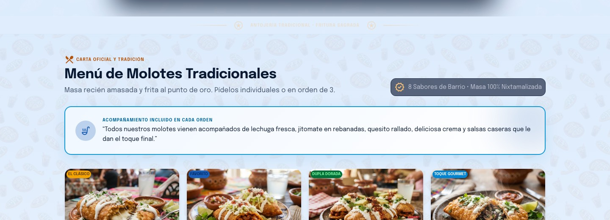 |
| Criterio | WCAG 2.2, 1.4.3 Contraste (mínimo) |
| Origen | `diseño fuente`: los tokens `on-primary: #002f67` y `primary-container: #1b5eb8` del `code.html` (`data-active-classes` y las etiquetas `text-[9px]`). `moloteando_tradicional/DESIGN.md` dice en cambio "fill `#1B5EB8` with white bold text": el diseño fuente se contradice |
| Severidad | Media: incumple AA, pero en un elemento secundario (escala de §3). El nombre, el precio y el botón de pedido de cada tarjeta se leen bien, y el enlace activo duplica "Inicio", que también es la marca |
| Recomendación | Texto blanco sobre `#1b5eb8` (6.29:1), como dice el `DESIGN.md`, y etiquetas de al menos 11-12 px |
| ¿Decisión sobre `_stich_source_`? | Sí: hay que decidir qué parte del diseño fuente manda |

### AUD-004: separadores y textos de sección de Molotes con poco contraste

| Campo | Contenido |
| --- | --- |
| Superficie y ruta | Landing Molotes, `/molotes`, sección del menú |
| Ancho | Todos |
| Descripción | El separador "Antojería tradicional • Fritura sagrada" casi no se ve. El antetítulo "Carta oficial y tradición" y la pastilla "8 Sabores de Barrio…" quedan por debajo del mínimo |
| Evidencia | Separador `#ffc472` sobre `#e0edfc` = **1.32:1** (10 px); antetítulo `#b45309` sobre el degradado: peor caso de la banda `#94bfe0` = **2.58:1** a 375 (mediana `#93c5e8` = 2.72:1; con `#93bfdf`, 2.57:1), y peor caso `#d6e4f1` = 3.88:1 a 1440 (mediana 4.18:1). El informe anterior daba 2.72, que era la mediana, no el peor caso. Otros muestreos de píxeles dan cifras algo distintas sin cambiar la conclusión (§2); pastilla `#c2c6d4` sobre `#56637a` = 3.56:1 a 1440 (4.13:1 a 375), en texto de 14 px. Captura:  |
| Criterio | WCAG 2.2, 1.4.3 Contraste (mínimo) |
| Origen | `diseño fuente`: `text-secondary` en el separador (`code.html`:63) y `text-on-surface-variant` sobre `bg-surface-container-high/70` en la pastilla |
| Severidad | Media: incumple AA (1.32-3.88:1), pero en textos decorativos o de apoyo del menú. Los títulos y los precios de la sección se leen |
| Recomendación | Objetivo: ≥ 4.5:1 en el peor caso. `#b45309` solo cumple sobre un fondo claro y opaco (5.02:1 sobre `#ffffff`); sobre el degradado azul no llega. Opciones: un fondo opaco claro tras el texto, o un color más oscuro, como `#7c2d12` (4.81:1 sobre `#94bfe0` y 9.37:1 sobre blanco) o el azul marino `#0b1d3a` (8.62:1 sobre `#94bfe0`). Para el separador sobre `#e0edfc`, cualquiera de esos dos. Para la pastilla, un fondo opaco más oscuro o el texto más claro |
| ¿Decisión sobre `_stich_source_`? | Sí |

### AUD-005: sin navegación entre secciones por debajo de 1024 px

| Campo | Contenido |
| --- | --- |
| Superficie y ruta | Landings Birria y Molotes: `/`, `/birria` y `/molotes` |
| Ancho | 375, 768 y 1023 (desde 1024 sí hay navegación) |
| Descripción | Ver §5.1. En el móvil no hay menú. Birria no tiene ningún atajo a sus secciones (menú, ubicación, horario); Molotes solo los tiene en el pie |
| Evidencia | `nav.site-nav` con `display: none` por debajo de 1024. En Molotes la navegación del pie empieza a unos 9 270 px de una página de 9 796 px. Capturas en §5.1 |
| Criterio | Regla del proyecto `.claude/rules/diseno-responsivo.md` (mobile-first) e historia HU-1. WCAG: se descarta 2.4.5. Posible incumplimiento de 1.4.10 (Reflow), según la interpretación: a 320 px y con el zoom al 200-400 % se pierde la navegación entre secciones |
| Origen | `diseño fuente`: `<nav class="hidden lg:flex">` sin botón de menú en los cuatro `code.html` (H2) |
| Severidad | Media |
| Recomendación | Añadir al diseño una navegación móvil: un `
` o un botón con `aria-expanded`, o una barra de anclas desplazable bajo la cabecera, diseñada con Stitch. Valorar el coste en JavaScript (R4) |
| ¿Decisión sobre `_stich_source_`? | Sí: ampliar el diseño fuente (C1, D2 y D5) |

### AUD-006: la cabecera del admin ocupa un tercio de la pantalla del móvil

| Campo | Contenido |
| --- | --- |
| Superficie y ruta | Admin, todas las pantallas con sesión (p. ej. `/birria/cotizador`) |
| Ancho | 375 (y 320, zoom 200 % y horizontal) |
| Descripción | Ver §5.2: hasta 9 enlaces repartidos en 5 filas. El contenido empieza a 273 px |
| Evidencia | Alto de la cabecera: 273 px a 375 (administrador en Birria), 217 px fuera de un negocio, 197 px para la editora, 337 px a 320 px (con `auditoria-admin`; depende de lo largo que sea el nombre: QA midió 325 px), 221 px de 400 con el zoom al 200 % y 181 px de 375 en horizontal. Captura en §5.2 |
| Criterio | Regla del proyecto `.claude/rules/diseno-responsivo.md` e historia HU-3. No incumple WCAG: no hay desborde y los objetivos miden ≥ 44 px |
| Origen | `implementación`: el `DESIGN.md` del admin no define una cabecera móvil |
| Severidad | Media |
| Recomendación | Un patrón móvil compacto: por ejemplo, una fila con la marca y un botón "Menú" (`
` o `aria-expanded`) que agrupe las secciones, la cuenta y la salida, con la subnavegación del negocio como pestañas desplazables. Diseñarlo con Stitch y aprobarlo antes de implementarlo (RN-4 y D4) |
| ¿Decisión sobre `_stich_source_`? | Sí: diseño con Stitch y su autorización para guardarlo |

### AUD-007: el CTA flotante tapa contenido

| Campo | Contenido |
| --- | --- |
| Superficie y ruta | Landings: `/molotes` (hero y pie) y `/birria` (tarjeta del hero y pie) |
| Ancho | 375 |
| Descripción | El botón flotante "Ordenar ya!" (174 × 50 px, abajo a la derecha) tapa parcialmente la mitad derecha de los botones del hero de Molotes al cargar, también cuando uno tiene el foco. Al final de las dos páginas tapa los textos "Aviso de Privacidad" y "Términos": el pie no deja espacio inferior. Esos textos no son enlaces ni reciben el foco (diferencia deliberada del README). En Birria tapa la tarjeta "Sáb y Dom" del hero |
| Evidencia | CTA flotante en `[177, 738, 174, 50]`; botón del hero con el foco en `[16, 731, 343, 48]`, que queda tapado en parte (`elementFromPoint` devuelve el CTA flotante). `padding-bottom` del pie: `0px`. **Foco en el pie** (rejilla de 15 puntos con `elementFromPoint`). Ronda 2, con Tab real: a 375 px, 0 % tapado en las dos landings; a 320 px, 0 % en Molotes y, en Birria, el teléfono un 27 % y el correo un 40 %. Ronda 1, enfocando con `focus()`: hasta un 40 % en "Ver ubicación" de Molotes a 375 px. QA midió 0 % en Molotes y 13 % en Birria. **La cifra depende del desplazamiento.** Al recibir el foco, el navegador desplaza lo mínimo para mostrar el elemento, y cerca del final de la página el desplazamiento llega a su máximo. Según el método y la altura de la página, el enlace enfocado queda más o menos bajo el CTA flotante. En ninguna medición quedó tapado por completo. Capturas: 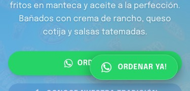 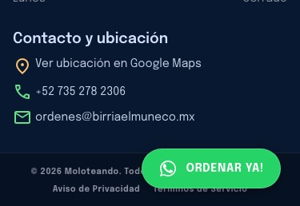 |
| Criterio | WCAG 2.2, 2.4.11 Foco no tapado (mínimo): **se cumple**, porque ningún elemento con el foco queda tapado por completo (comprobado en el hero y en el pie, a 375 y a 320 px). Sí se incumple 2.4.12 (AAA), que no admite ni la ocultación parcial, y la regla del proyecto `.claude/rules/accesibilidad.md` (foco visible) |
| Origen | `implementación`: el CTA flotante viene del diseño (`fixed bottom-6`), pero el hueco que se le reserva al final de la página es cosa de la implementación |
| Severidad | Media |
| Recomendación | Reservar al final de la página el alto del CTA más su margen (≈ 80 px) y, en el hero, no mostrar el flotante mientras el CTA del hero esté visible (un `IntersectionObserver`, o solo CSS si es posible) |
| ¿Decisión sobre `_stich_source_`? | No para el espacio reservado. Sí si se cambia cuándo aparece el CTA |

### AUD-008: con el aviso abierto, el fondo se sigue desplazando

| Campo | Contenido |
| --- | --- |
| Superficie y ruta | Avisos de `/` y de `/molotes` |
| Ancho | Todos |
| Descripción | Con el aviso modal abierto, la rueda o el gesto desplazan la página que hay detrás |
| Evidencia | Medición: `scrollY` pasa de 0 a 600 tras una rueda de 600 px con el `<dialog>` abierto, en los 4 avisos y en los 3 anchos |
| Criterio | Ninguno de WCAG. Es un caso límite del ticket (UX) |
| Origen | `implementación` |
| Severidad | Baja |
| Recomendación | `html:has(dialog[open]) { overflow: hidden; }` (CSS, sin JavaScript) |
| ¿Decisión sobre `_stich_source_`? | No |

### AUD-009: el aviso de `/` tiene un "¡Ordenar ya!" que no hace un pedido

| Campo | Contenido |
| --- | --- |
| Superficie y ruta | Aviso "Molotes" de `/` (martes a viernes) |
| Ancho | Todos |
| Descripción | La acción principal del aviso dice "¡Ordenar ya!", igual que los botones de WhatsApp, pero lleva a la landing `/molotes`, no al pedido |
| Evidencia | Acción `A: ¡ORDENAR YA! -> /molotes` (295 × 60 px). Captura: 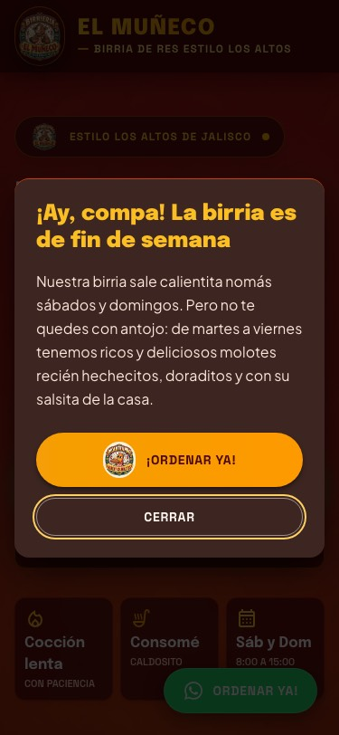 |
| Criterio | WCAG 2.2, 2.4.4 Propósito de los enlaces (en contexto): se cumple por poco con el texto del aviso. Regla `.claude/rules/accesibilidad.md`: texto significativo en los botones |
| Origen | `implementación`: el texto vive en el contenido de Birria (`src/content/birria/`) |
| Severidad | Baja |
| Recomendación | "Ver los molotes" o "Ir a Molotes" |
| ¿Decisión sobre `_stich_source_`? | No (es contenido) |

### AUD-010: los mapas embebidos añaden 16 paradas de teclado

| Campo | Contenido |
| --- | --- |
| Superficie y ruta | Landings Birria (`/birria`, `birria.html`:252) y Molotes (`/molotes`, `molotes.html`:269), sección de ubicación |
| Ancho | 375 y 1440 |
| Descripción | Al tabular, el foco entra en el iframe de Google Maps y recorre sus controles antes de llegar al pie. Los dos iframes tienen `title` ("Ubicación de Birria El Muñeco en Google Maps" y "Ubicación de Moloteando en Google Maps"), lo cual es correcto, y `loading="lazy"` |
| Evidencia | Medición: en Birria, 16 de las 39 paradas de un ciclo completo a 375 (22 del documento + 16 del iframe + 1 en la que el foco sale de la página) y 16 de 45 a 1440 (28 + 16 + 1). En Molotes, el primer recorrido no entró en el mapa porque el iframe aún no se había cargado (`loading="lazy"`, con 260 ms entre pulsaciones). En la remedición, con el mapa desplazado a la vista y 5 s de espera, también hay **16 paradas** dentro del iframe, entre "Activar promoción" y "Cómo llegar" |
| Criterio | Regla `.claude/rules/accesibilidad.md` (navegación con teclado). No incumple WCAG: se puede salir del iframe |
| Origen | `implementación`: los mapas embebidos son una diferencia deliberada con el diseño (README) |
| Severidad | Baja |
| Recomendación | Cargar el mapa bajo demanda (una imagen con el enlace "Abrir en Google Maps", que ya existe) o sacarlo del orden de tabulación con un enlace equivalente |
| ¿Decisión sobre `_stich_source_`? | No |

### AUD-011: objetivos táctiles por debajo de los 44 px recomendados

| Campo | Contenido |
| --- | --- |
| Superficie y ruta | Landings: enlaces del pie de Molotes, teléfono, correo y ubicación de los dos pies, y variantes de las tarjetas de Birria |
| Ancho | 375 |
| Descripción | Cumplen el mínimo de AA (24 px o la excepción de espaciado), pero son pequeños para el pulgar |
| Evidencia | Navegación del pie de Molotes: 116-216 × **14 px**. Teléfono, correo y ubicación: 113-208 × **20-22 px**. Variantes de Birria ("Con Carne ($80)"): 128 × **30 px**. Todos cumplen la excepción de espaciado de 2.5.8. Separaciones medidas a 375 px: los enlaces del pie de Molotes (14 px de alto) tienen 12 px de hueco vertical entre sí, y del centro de cada uno al borde del vecino hay 19 px (hacen falta ≥ 12 px para que el círculo de 24 px no lo corte). Ubicación, teléfono y correo (22 px): huecos de 10-13 px, con distancias de 21-24 px. En el admin todos miden ≥ 44 px de alto, salvo las casillas de 20 × 20 px, que también cumplen la excepción |
| Criterio | Recomendación de 44 × 44 px (`.claude/rules/accesibilidad.md`, ticket). WCAG 2.5.8 se cumple |
| Origen | `diseño fuente`: tamaños y espaciados de los `code.html` |
| Severidad | Baja |
| Recomendación | Subir el área táctil a ≥ 44 px de alto con `padding` (`min-h-11`) sin cambiar el aspecto |
| ¿Decisión sobre `_stich_source_`? | Sí, si cambia el espaciado visible |

### AUD-012: el icono de persona de la cabecera de Molotes parece un botón

| Campo | Contenido |
| --- | --- |
| Superficie y ruta | Landing Molotes, cabecera |
| Ancho | Todos |
| Descripción | Un círculo con el icono "person" junto al CTA parece un acceso a una cuenta, pero no hace nada (`aria-hidden`, no es un enlace) |
| Evidencia | `person` de 32 × 32 px. Captura:  |
| Criterio | Regla `.claude/rules/accesibilidad.md` (elementos con significado claro). Coherencia de la interfaz |
| Origen | `diseño fuente`: `
person
` en `code.html` |
| Severidad | Baja |
| Recomendación | Quitarlo o cambiarlo por algo que no parezca un control |
| ¿Decisión sobre `_stich_source_`? | Sí |

### AUD-013: dos enlaces de la navegación de Birria van al mismo sitio

| Campo | Contenido |
| --- | --- |
| Superficie y ruta | Landing Birria, navegación de escritorio |
| Ancho | ≥ 1024 |
| Descripción | "Menú de Birria" y "Quesabirrias & Consomé" llevan al mismo ancla, `#menu-especialidades` |
| Evidencia | `nav` → `Menú de Birria -> #menu-especialidades` y `Quesabirrias & Consomé -> #menu-especialidades` |
| Criterio | WCAG 2.4.4 se cumple. Es coherencia de la navegación |
| Origen | `diseño fuente`: los mismos `href` en `birrier_a_el_mu_eco_aut_ntica_birria_de_res_color_adobo/code.html` |
| Severidad | Baja |
| Recomendación | Un solo enlace, o un ancla propia para las quesabirrias |
| ¿Decisión sobre `_stich_source_`? | Sí |

### AUD-014: en horizontal y con el zoom, la cabecera fija y el CTA flotante quitan mucho espacio

| Campo | Contenido |
| --- | --- |
| Superficie y ruta | Landings Molotes y Birria |
| Ancho | Horizontal (812 × 375) y zoom al 200 % (640 × 400) |
| Descripción | En Molotes, la cabecera fija (113 px, con la franja de horario) y el CTA flotante (50 px) dejan unos 210 px útiles de 375. En Birria, la cabecera mide 81 px. No hay desborde horizontal |
| Evidencia | Horizontal: cabecera de Molotes de 113 px y de Birria de 81 px; zoom al 200 %: 113 de 400 y 81 de 400; CTA flotante de 50 px. Captura: 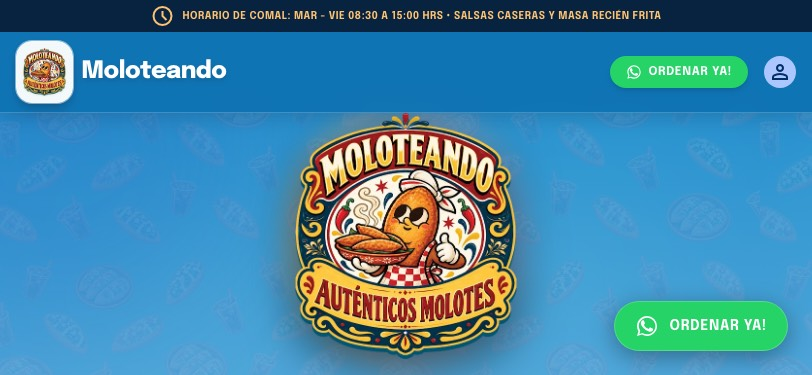 |
| Criterio | WCAG 1.4.4 y 1.4.10 se cumplen solo en cuanto a desborde: no hay desplazamiento horizontal. La pérdida de la navegación entre secciones en esos anchos se trata en AUD-005. Regla `.claude/rules/diseno-responsivo.md` |
| Origen | `diseño fuente`: `<header class="fixed top-0 …">` en los `code.html` móviles |
| Severidad | Baja |
| Recomendación | Cabecera que se oculta al desplazar hacia abajo, o no fija cuando la pantalla es baja (`@media (max-height: 500px)`) |
| ¿Decisión sobre `_stich_source_`? | Sí |

### AUD-015: un nombre de usuario largo desordena la cabecera del admin

| Campo | Contenido |
| --- | --- |
| Superficie y ruta | Admin, cabecera (editora con un nombre visible de 60 caracteres) |
| Ancho | 375 |
| Descripción | El nombre ocupa tres líneas y "Mi cuenta" se parte en dos. No se corta ni desborda |
| Evidencia | Captura: 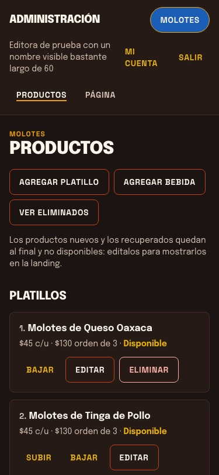 |
| Criterio | Regla `.claude/rules/diseno-responsivo.md` |
| Origen | `implementación` |
| Severidad | Baja |
| Recomendación | Dentro del patrón móvil de AUD-006: el nombre en su propia línea, recortado con `text-overflow: ellipsis` y el nombre completo en `title` o en "Mi cuenta" |
| ¿Decisión sobre `_stich_source_`? | Junto con AUD-006 |

### AUD-016: colores hexadecimales sueltos en la plantilla de Birria (H3)

| Campo | Contenido |
| --- | --- |
| Superficie y ruta | `restaurante/landing-pages/src/views/pages/birria.html` |
| Ancho | No aplica |
| Descripción | 100 apariciones de color hexadecimal literal (`bg-[#…]`, `text-[#…]`) en 57 líneas; 53 clases distintas y 42 colores distintos, de los que 41 aparecen tal cual en los `code.html` de Birria |
| Evidencia | `grep -o '\[#[0-9a-fA-F]\{3,8\}\]'` sobre la plantilla, comparado con los `code.html` de escritorio y móvil |
| Criterio | Mantenimiento (`.claude/rules/tailwind.md`). No es un defecto visual |
| Origen | `diseño fuente` |
| Severidad | Baja |
| Recomendación | Derivado C (opcional): pasarlos a tokens `@theme` sin cambio visual, con una comparación de capturas antes y después (R5) |
| ¿Decisión sobre `_stich_source_`? | No: no cambia el diseño |

### AUD-017: colores hexadecimales propios en la plantilla de Molotes (H3)

| Campo | Contenido |
| --- | --- |
| Superficie y ruta | `restaurante/landing-pages/src/views/pages/molotes.html` |
| Ancho | No aplica |
| Descripción | 41 apariciones de color hexadecimal literal en 34 líneas; 15 clases distintas y 15 colores distintos, de los que solo 2 están en los `code.html` de Moloteando. Los demás los añadió la implementación (p. ej. `#25D366`, `#334155` y `#081830`) |
| Evidencia | El mismo `grep`, comparado con los `code.html` de Moloteando |
| Criterio | Mantenimiento (`.claude/rules/tailwind.md`) |
| Origen | `implementación` |
| Severidad | Baja |
| Recomendación | Derivado C, junto con AUD-016 |
| ¿Decisión sobre `_stich_source_`? | No |

### AUD-018: faltan las capturas de referencia del diseño fuente

| Campo | Contenido |
| --- | --- |
| Superficie y ruta | `_stich_source_/` |
| Ancho | Escritorio y móvil |
| Descripción | `birrier_a_el_mu_eco_aut_ntica_birria_de_res_color_adobo/screen.png` es un archivo de texto de 28 bytes, no una imagen. Los `screen.png` móviles son miniaturas de 45 × 1600 y 58 × 1600 px. El de escritorio de Moloteando sí es válido (1280 × 4459) y se usó (§2). Para Birria escritorio y para las dos landings en móvil, la comparación visual solo pudo hacerse con los `code.html`: la parte visual queda INCONCLUSIVE, como indica `browser-qa` |
| Evidencia | `file` y `sips -g pixelWidth -g pixelHeight` de esos archivos |
| Criterio | `.claude/CLAUDE.md` §3: fuente de verdad del diseño |
| Origen | `diseño fuente` |
| Severidad | Baja |
| Recomendación | Volver a exportar de Stitch las capturas de escritorio y móvil de las dos landings |
| ¿Decisión sobre `_stich_source_`? | Sí: autorizar que se actualicen los archivos de `_stich_source_` |

### AUD-019: al enviar el formulario del club de Molotes se pierde el foco

| Campo | Contenido |
| --- | --- |
| Superficie y ruta | Landing Molotes, `/molotes`, formulario del club (`data-promo-form`) |
| Ancho | 375 |
| Descripción | Al enviar el formulario con datos válidos, se oculta y aparece el mensaje de éxito (`role="status"`), pero el foco, que estaba en el formulario, cae en `body`. El usuario de teclado vuelve al principio de la página. En Birria el formulario no se oculta y el foco se queda en el campo |
| Evidencia | Medición con un valor ficticio (`prueba@example.invalid`, sin petición de red: el formulario no envía nada, `promo-form.js`): después de enviar, `document.activeElement` es `BODY` y `form.hidden` es `true` |
| Criterio | WCAG 2.2, 2.4.3 Orden del foco (pérdida del foco) y regla `.claude/rules/formularios.md` (estados claros de éxito) |
| Origen | `diseño fuente`: `handleSubscribe()` del diseño de Moloteando oculta el formulario (`data-promo-hide-on-success`) |
| Severidad | Baja |
| Recomendación | Mover el foco al mensaje de estado (`tabindex="-1"` y `focus()`) o no ocultar el formulario |
| ¿Decisión sobre `_stich_source_`? | No para mover el foco. Sí si se deja de ocultar el formulario |

### AUD-020: el campo del club de Birria acepta teléfono pero se autocompleta como correo

| Campo | Contenido |
| --- | --- |
| Superficie y ruta | Landing Birria, `/birria`, formulario del club (`birria.html`:308) |
| Ancho | Todos |
| Descripción | El campo "Correo electrónico o teléfono" es `type="text"` (diferencia deliberada: acepta teléfonos) con `autocomplete="email"`, y su etiqueta solo existe para lectores de pantalla (`sr-only`). Lo visible es el `placeholder` |
| Evidencia | Campo `contact:text*`, `autocomplete=email`; nombre accesible "Correo electrónico o teléfono" (árbol de accesibilidad) |
| Criterio | WCAG 2.2, 1.3.5 Propósito de los campos (el `autocomplete` describe solo parte del propósito) y regla `.claude/rules/formularios.md` (tipos y etiquetas apropiados) |
| Origen | `implementación` |
| Severidad | Baja |
| Recomendación | Dos campos (correo y teléfono, con `type` y `autocomplete` propios), o quitar el `autocomplete` y mostrar una etiqueta visible |
| ¿Decisión sobre `_stich_source_`? | No |

### AUD-021: en los campos del admin, el foco solo cambia el color del borde

| Campo | Contenido |
| --- | --- |
| Superficie y ruta | Admin: todos los campos de texto, contraseña, `select` y `textarea` (p. ej. `/acceso`, `/birria/productos/11/editar` y el Cotizador) |
| Ancho | Todos |
| Descripción | Al recibir el foco, el campo no muestra `outline` ni anillo: solo cambia el color de su borde de 1 px, que pasa de marrón grisáceo a naranja. Los enlaces y botones sí tienen un `outline` amarillo de 2 px. El cambio en los campos cuesta verlo, sobre todo en los formularios largos |
| Evidencia | Medido en el navegador (`getComputedStyle` en reposo y con `:focus-visible`): borde `#ab8985` → `#c2410c` (1 px renderizado; la clase es `border-[1.5px]`); `outline` sólido de 2 px **transparente** (`rgba(0, 0, 0, 0)`); `box-shadow` sin anillo (`focus:ring-0`). Igual en `input[type=text]`, `select` y `textarea`. Ratios con la fórmula de WCAG: **entre los dos estados, 1.64:1**; borde con el foco frente al fondo del campo `#1c1412`, 3.50:1, y frente al de la tarjeta `#261a17`, 3.26:1 (en reposo, 5.74 y 5.35). Capturas: 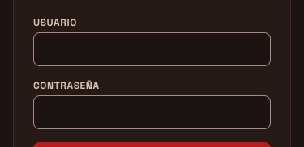 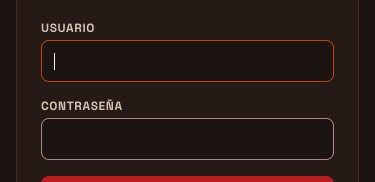 |
| Criterio | WCAG 2.2, 2.4.7 Foco visible (AA): el indicador existe, pero el cambio entre estados es de 1.64:1 y el borde mide 1 px. Es un incumplimiento según la interpretación habitual de "visible", y no cumple la referencia de 2.4.13 (AAA: un cambio de ≥ 3:1 en un área de ≥ 2 px de perímetro). 1.4.11 se cumple para el borde con el foco frente a los fondos adyacentes (≥ 3:1). Regla del proyecto `.claude/rules/accesibilidad.md` (estados de foco visibles) |
| Origen | `diseño fuente`: `_stich_source_/birrier_a_el_mu_eco/DESIGN.md`, "Inputs & Quantity Selectors": "Focus state triggers a vibrant 1.5px border in `#c2410c` with zero outer fuzzy halo". La implementación lo sigue (`focus:border-adobo focus:ring-0`) y anula para los campos el `:focus-visible { outline: 2px solid maiz }` global |
| Severidad | Media: afecta a los formularios del admin, que son la tarea principal de los editores, pero el indicador existe y es perceptible con atención |
| Recomendación | Aplicar también a los campos el `outline` de 2 px `#eab308` con `outline-offset: 2px` que ya usan los botones (9.45:1 sobre `#1c1412`), o un borde de 2 px más un anillo, con un cambio de ≥ 3:1 frente al estado en reposo |
| ¿Decisión sobre `_stich_source_`? | Sí: contradice el "zero outer fuzzy halo" del `DESIGN.md` del admin (derivado A, D4) |

## 8. Estados del contenido

| Estado | Landings | Admin |
| --- | --- | --- |
| Carga | No aplica: el HTML llega completo del servidor y `public/js` no pide datos | No aplica: el HTML llega completo del servidor; el envío de un formulario es una navegación normal |
| Vacío | **Sin probar**: vaciar el catálogo exige borrar productos | Probado: "No hay productos eliminados.", "No hay números bloqueados." y "Hoy ningún número ha alcanzado un tope." |
| Error | Probado: el formulario del club de las dos landings (`data-promo-form`, `required`) se valida en el navegador. Enviado vacío, el navegador muestra su mensaje ("Please fill out this field." en el Chrome de la prueba) y lleva el foco al primer campo inválido. Sin petición de red. Con la `api` parada no hay error visible (ver "parcial") | Probado: los formularios de usuario y de producto enviados vacíos muestran un resumen de errores (`role="alert"`, recibe el foco) y marcan los campos con `aria-invalid` (10 en el de producto). También se vieron la 404 y la 503 con la `api` parada, sin cabecera y con "Volver al inicio" |
| Parcial | Probado: con la `api` parada, `/birria` sirve la semilla (6 tarjetas; `landing_products_fallback` y `landing_page_fallback` en el log), sin que el cliente lo note | **Sin probar**: el aviso "La base de datos no respondió" de "Bot" exige tirar MySQL con la `api` en marcha |
| Éxito | Probado: con valores ficticios, el formulario del club muestra un mensaje del cliente con `role="status"`, sin enviar nada. Birria: "¡Listo! Pregunta por la promoción vigente…", con el foco en el campo. Molotes: "¡Gracias por tu interés!…"; el formulario se oculta y el foco se pierde (AUD-019). El pedido sale a WhatsApp | Probado: "Usuario creado: ya puede entrar con su contraseña." y "Cambios guardados…" (`role="status"`) |
| Permiso | No aplica: las landings son públicas | Probado: la editora recibe un 403 "Sin permiso" en `/usuarios`, `/bot`, `/birria/productos` y `/birria/cotizador`, con la cabecera reducida a su negocio |

El control de evidencia de `frontend-design-direction` (`check-evidence.js`) se pasó sobre los registros de los dos grupos (fuera del repositorio). Falla a propósito en los dos estados **sin probar**: "vacío" en las landings y "parcial" en el admin. El comprobador no admite "sin probar" y no se fabricó evidencia. "Error" y "éxito" de las landings, que antes se dieron por no aplicables, se probaron en la remedición.

## 9. Consistencia visual

Se usa la auditoría visual de `design-system` (modo 2): puntuación de 0 a 10 en las 9 dimensiones que aplican. "Modo oscuro" no aplica.

| Dimensión | Landings | Admin | Nota |
| --- | ---: | ---: | --- |
| Consistencia del color | 6 | 9 | Landings: hexadecimales sueltos (AUD-016 y AUD-017). Admin: tokens del `DESIGN.md` |
| Jerarquía tipográfica | 8 | 8 | Un `h1` por página y niveles sin saltos |
| Ritmo del espaciado | 8 | 8 | Escalas `space-*` (Molotes) y de Tailwind |
| Consistencia de los componentes | 7 | 8 | El CTA de WhatsApp tiene tres variantes. En el admin, "Subir" y "Bajar" son texto sin borde y "Editar" y "Eliminar" llevan borde |
| Comportamiento responsivo | 5 | 6 | Sin menú móvil (AUD-005) y cabecera alta en el admin (AUD-006). Sin desbordes |
| Animación | 8 | 9 | Solo con `motion-safe` y desplazamiento suave nativo |
| Accesibilidad | 5 | 8 | Contrastes del diseño fuente (AUD-001 a AUD-004). En el admin, el foco de los campos es poco visible (AUD-021) |
| Densidad de información | 7 | 7 | Las páginas de las landings son largas a 375 (unos 9 800 px) |
| Acabado | 8 | 8 | Estados de foco, de error y de éxito completos |

## 10. Decisiones para el usuario (D2 y D3)

1. **C1, navegación móvil de las landings (AUD-005):**
   - ¿se amplía `_stich_source_` con una navegación móvil, diseñada con Stitch y aprobada antes de implementarla?
   - Opciones: menú plegable, barra de anclas bajo la cabecera, o nada (se queda como está).
2. **C2, contrastes del diseño fuente (AUD-001 a AUD-004):** ¿se corrigen?
   - Para el verde de WhatsApp (AUD-001): texto oscuro sobre el mismo verde, o un verde más oscuro con texto blanco.
   - Para el hero de Molotes (AUD-002): una capa oscura bajo el texto, o un fondo más oscuro.
   - Para AUD-003: ¿manda el `DESIGN.md` (texto blanco) o el `code.html`?
3. **El patrón móvil del admin (AUD-006 y AUD-015) y el foco de sus campos (AUD-021):** ¿se diseña con Stitch (D4)? ¿Se aparta del "zero outer fuzzy halo" del `DESIGN.md` para que el foco de los campos se vea?
4. **CTA flotante (AUD-007):** ¿basta con el espacio reservado, o también se oculta mientras se ve el CTA del hero?
5. **Los hallazgos Baja del diseño fuente (AUD-011 a AUD-014, AUD-018 y AUD-019):** ¿cuáles se aprueban? AUD-018 exige autorizar que se actualicen los archivos de `_stich_source_`.
6. **¿Se crea el derivado C (AUD-016 y AUD-017)?**
7. **D3:** la partición final en tickets derivados (abajo).

## 11. Propuesta de tickets derivados

| Ticket | Alcance | Hallazgos | Depende de |
| --- | --- | --- | --- |
| **A: admin** | Patrón móvil de la cabecera y de la navegación por negocio, nombre largo y foco visible en los campos | AUD-006, AUD-015 y AUD-021 | Diseño con Stitch aprobado (D4); se puede hacer en uno o varios PR |
| **B1: landings, implementación** | Lo que no cambia el diseño fuente: espacio para el CTA flotante, fondo fijo con el aviso abierto, texto del aviso de `/` y mapa sin trampa de tabulación | AUD-007, AUD-008, AUD-009, AUD-010, AUD-019 (mover el foco al mensaje) y AUD-020. Además, la sugerencia de llevar el foco a `main` al cerrar un aviso (§6) | Nada |
| **B2: landings, diseño fuente** | Contrastes y navegación móvil, solo lo que el usuario apruebe | AUD-001, AUD-002, AUD-003, AUD-004, AUD-005, AUD-011, AUD-012, AUD-013 y AUD-014 | Decisiones 1, 2 y 5 (D2 y D5); Stitch para la navegación móvil |
| **C: mantenimiento (opcional)** | Pasar los colores hexadecimales a tokens sin cambio visual | AUD-016 y AUD-017 | Decisión 6 |
| **D: referencias del diseño (opcional)** | Volver a exportar las capturas de `_stich_source_` | AUD-018 | Autorización sobre `_stich_source_`; conviene antes de B2 |

Todos los hallazgos están en algún derivado.
